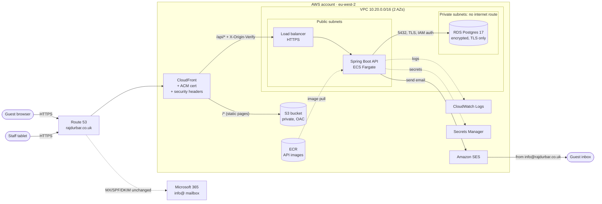
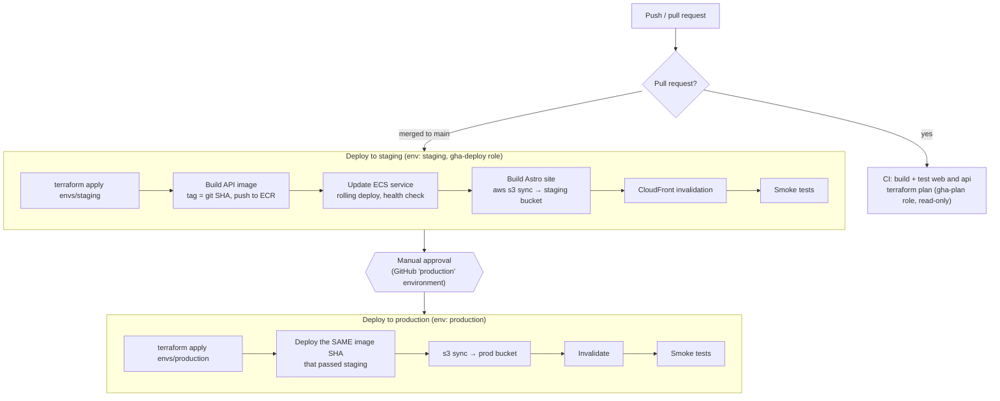
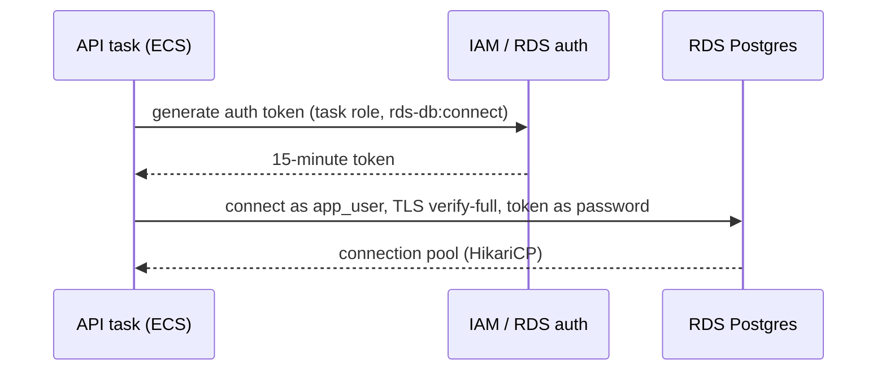
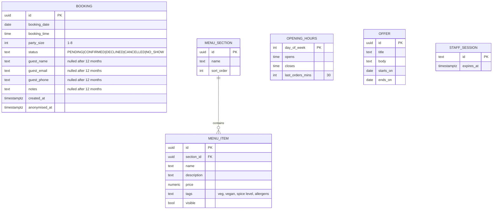
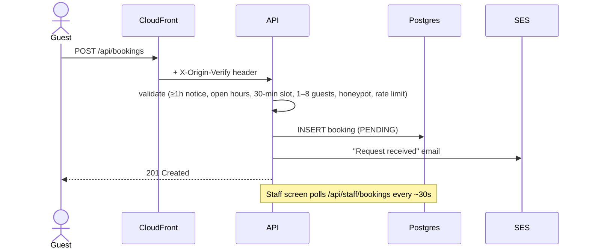

# Raj Durbar website: high-level design (HLD)

Status: **draft v0.1**, 14 Nov 2026. Builds on [requirements.md](requirements.md) and the existing
Terraform in [`infra/`](../infra). Region: **London (eu-west-2)**, apart from the CloudFront
certificate, which must be in us-east-1.

## 1. Architecture at a glance

**In one sentence:** the site is static files in S3, served through CloudFront. CloudFront also
forwards `/api/*` to a small Spring Boot container, which is the **only** thing that can talk to
the Postgres database. The database sits in private subnets with no internet access.

| Component | AWS service | Terraform | Purpose |
|---|---|---|---|
| DNS | Route 53 hosted zone | *new* `modules/dns` | rajdurbar.co.uk records, M365 records, SES records |
| TLS | ACM (us-east-1) | *new*, in `modules/dns` or `web` | Certificate for apex + `www` (+ `staging`) |
| CDN / front door | CloudFront | `modules/web` ✅ | HTTPS, caching, security headers, `/api/*` routing |
| Static website | S3 (private, OAC) | `modules/web` ✅ | Astro build output |
| API | ECS Fargate (Express Mode) + ALB | *new* `modules/api` | Bookings, staff login, content admin |
| Image registry | ECR | `modules/ecr` ✅ | API container images (immutable tags, scanned) |
| Database | RDS PostgreSQL 17, db.t4g.micro | `modules/database` ✅ | Bookings, menu, hours, offers |
| Network | VPC, 2 public + 2 private subnets, no NAT | `modules/network` ✅ | Isolation |
| Email | SES | *new* `modules/email` | Guest booking emails |
| Secrets | Secrets Manager | DB module ✅ + API module | DB master password (RDS-managed), session/origin secrets |
| Logs / alerts | CloudWatch | *new*, in `modules/api` | API logs, alarms (5xx, DB CPU/storage) |

## 2. How the website is deployed

Everything deploys from **GitHub Actions** using the OIDC roles the bootstrap already created.
**No AWS keys are stored anywhere.**

### 2.1 Website (static frontend)
1. `npm ci && npm run build` in `web/`. Astro writes one folder per page, e.g. `menu/index.html`.
2. `aws s3 sync dist/ s3://<site_bucket> --delete`, with long cache headers on hashed assets
   (`/_astro/*`) and short ones on HTML.
3. `aws cloudfront create-invalidation --paths "/*"`.
4. The existing CloudFront function rewrites `/menu` to `/menu/index.html`. Missing pages show `404.html`.

The menu, opening hours and offers are **not** baked into the build. The pages fetch them from
`/api/public/...`, so staff edits appear at once without a redeploy. Static fallback text in the
HTML keeps the pages useful if the API is down.

### 2.2 API (Spring Boot container)
1. `./gradlew test bootJar`, then `docker build` (Java 21, small JRE base image, non-root user),
   targeting ARM64 (Graviton) for lower Fargate cost.
2. Push to ECR, tagged with the **git commit SHA**. Tags are immutable, so production deploys
   exactly what staging tested.
3. Update the ECS service to the new image. ECS starts the new task, waits for `/actuator/health`
   to pass on the load balancer, then stops the old one, so there's no downtime.
4. Database schema changes ship *inside* the app as **Flyway migrations** and run at startup, before
   the app accepts traffic. Migrations are written to be backward-compatible, so the old and new
   versions can briefly run side by side.

### 2.3 Infrastructure
- `terraform plan` runs on every pull request and is posted for review.
- `terraform apply` runs on merge, staging first, then production after approval.
- The README rule stands: every change under `infra/` needs a human review.

### 2.4 Environments

| | Staging | Production |
|---|---|---|
| URL | `staging.rajdurbar.co.uk` | `rajdurbar.co.uk` (`www` redirects) |
| Terraform | `infra/envs/staging` ✅ | `infra/envs/production` (*new*, same modules) |
| DB | deletion protection off, can be rebuilt | deletion protection **on**, final snapshot |
| Deploy | automatic on merge to `main` | after manual approval |
| Cost saving | ECS desired count can be set to 0 and the DB stopped when idle | always on |

## 3. The database: where it sits and how we connect

### 3.1 Where it sits
- **RDS PostgreSQL 17**, `db.t4g.micro`, 20 GB gp3 (auto-grows to 50 GB), encrypted at rest.
- In the VPC's **two private subnets**. Their route table has **no route to the internet**, and the
  instance is `publicly_accessible = false`. It has no public address, so it can't be reached from outside AWS at all.
- **Security group:** port 5432 is allowed **only from the API's security group**, and nothing else can connect.
- `rds.force_ssl = 1`, so unencrypted connections are refused.
- Single-AZ to keep costs down (`multi_az` can be switched on later). Automated daily backups are kept
  7 days, in the 03:00–04:00 window.

### 3.2 How the API connects

- The API connects as a **limited `app_user`**, not the master user. It can only
  read and write the application tables; it can't drop tables or create users.
- It uses **IAM database authentication**: the ECS task role grants `rds-db:connect` for `app_user`,
  and the app (AWS Advanced JDBC Wrapper, IAM plugin) creates short-lived tokens. That means
  **no app password to store, leak or rotate**. It also avoids a known pitfall: RDS rotates the
  managed master password automatically, and a password injected only at container start would
  stop working after a rotation.
- JDBC URL: `jdbc:aws-wrapper:postgresql://<db-endpoint>:5432/rajdurbar?sslmode=verify-full`,
  with the RDS CA bundle included in the image.
- HikariCP pool, at most about 10 connections. `db.t4g.micro` handles that comfortably.
- **Flyway** runs migrations at startup, using a separate `migrator` role with schema-change
  rights. `app_user` and the `migrator` role are created in the first migration step.

### 3.3 How people connect (admin and debugging)
There's no bastion server and no public database port. When a person needs `psql`:

1. `aws sso login --profile rajdurbar` (Identity Center, MFA).
2. Open a **Session Manager port-forward through the running API task** (ECS Exec):
   `aws ssm start-session --target ecs:<cluster>_<taskId>_<runtimeId> --document-name AWS-StartPortForwardingSessionToRemoteHost --parameters host=<db-endpoint>,portNumber=5432,localPortNumber=15432`
3. Connect `psql`/DBeaver to `localhost:15432`. The master password is read from Secrets Manager
   (`db_master_secret_arn` output) only when needed.

Every session is logged in CloudTrail. Day-to-day data changes go through the staff screen, not SQL.

### 3.4 What's stored

- **GDPR job:** a daily scheduled task inside the API (Spring `@Scheduled` with a database lock so
  only one task runs it) blanks the guest fields on bookings more than 12 months old and sets
  `anonymised_at`. Each run is logged with a count.
- Guest data is never written to logs (log messages use the booking ID only).

## 4. Request flows

**Guest books a table**

**Staff confirm:** staff sign in (shared password, Argon2 hash, rate-limited, HttpOnly + Secure +
SameSite=Strict session cookie, 12-hour idle timeout). Confirming or declining runs
`PATCH /api/staff/bookings/{id}`, which updates the row and sends the guest an email through SES.

Because the site and the API share one domain through CloudFront, the browser doesn't need any
cross-origin (CORS) setup and the session cookie is first-party. The API rejects requests
without the `X-Origin-Verify` header, so clients can't bypass CloudFront by calling the load
balancer directly.

## 5. Security summary

| Layer | Control |
|---|---|
| Edge | HTTPS only, HSTS, CSP, X-Frame-Options DENY, security headers (in `modules/web`) |
| S3 | Private, readable only by this CloudFront distribution (OAC), TLS-only bucket policy |
| API | Only reachable via CloudFront (secret header + ALB security group), input validation, rate limits |
| DB | Private subnets, SG only from the API, TLS enforced, encrypted, IAM auth, least-privilege user |
| Secrets | Secrets Manager. RDS manages the master password; nothing is in git or Terraform state |
| CI/CD | GitHub OIDC; deploy role only from `staging`/`production` environments on `main`; prod approval |
| Audit | CloudTrail, IAM Access Analyzer, budget alerts (bootstrap ✅) |

An optional later addition is AWS WAF on CloudFront (about $8–10/month), if bots or spam
bookings become a problem.

## 6. Cost estimate (production, monthly, eu-west-2, approximate)

| Item | Approx. |
|---|---|
| RDS db.t4g.micro + 20 GB gp3 + backups | $15 |
| ECS Fargate, 1 task 0.5 vCPU / 1 GB ARM | $15 |
| Application Load Balancer | $18 |
| Public IPv4 addresses (ALB + task) | $8 |
| CloudFront, S3, Route 53, SES, CloudWatch, Secrets Manager | $3–5 |
| **Total** | **≈ $60 (≈ £47)** |

This is at the top of the £30–50 target, and staging roughly doubles it while it's running.
**Mitigations:**
- run staging only when needed: scale ECS to 0 and stop RDS (RDS restarts itself after 7 days, so a scheduled stop handles that);
- use the AWS credits from the new account;
- if costs must fall further, a later option is replacing the ALB with an API Gateway + VPC link, or
  moving the API to Lambda (SnapStart). That's a larger change, so it's not done in v1.

## 7. Build order

1. `modules/dns`: Route 53 zone with **copies of all GoDaddy/M365 records**, ACM certificates,
   SES domain identity. Nameservers aren't switched yet.
2. `modules/api`: ECS Express Mode service, ALB, task role (IAM DB auth, SES send), log group,
   origin-verify secret. Then wire `api_origin_domain` into `modules/web`.
3. `web/` (Astro) and `api/` (Spring Boot + Flyway) code, plus GitHub Actions workflows (`ci.yml`, `deploy.yml`).
4. Stand up staging, test end to end, request SES production access.
5. `infra/envs/production`, then cut over DNS from Wix (see [requirements §4](requirements.md#4-environments-and-cutover)).
